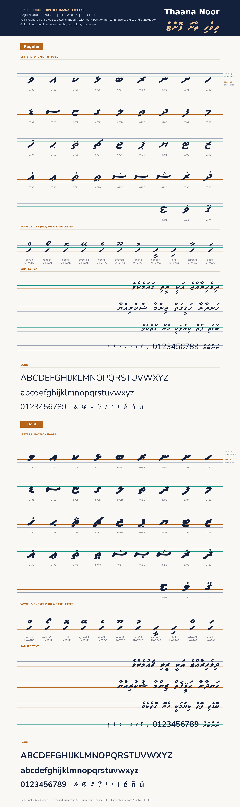

# Thaana Noor
Open source Dhivehi (Thaana) typeface, Regular (400) + Bold (700). Copyright 2026 Areesh. SIL OFL 1.1 (OFL.txt): free to use, embed, bundle and redistribute.

Formats: `dist/ttf` (apps, Android/iOS/desktop), `dist/webfonts` (WOFF2). Embedding flag is open (fsType 0).
Coverage: Thaana U+0780-07B1 with fili/sukun positioning (GPOS) and kerning, Latin letters (Basic Latin + Latin-1), digits, punctuation, Arabic ، ؟, NBSP, ZWNJ/ZWJ/LRM/RLM.
Latin letters are from Nunito (SIL OFL 1.1, see OFL.txt); for other scripts add a fallback font.

## Web
`<link rel="stylesheet" href="css/thaana-noor.css">` then `<p class="dhivehi" lang="dv">...</p>` (see example.html). Or: `npm i` the folder and import the CSS.

## Expo / React Native
```js
const [loaded] = useFonts({ 'ThaanaNoor': require('./assets/fonts/ThaanaNoor-Regular.ttf'),
                            'ThaanaNoor-Bold': require('./assets/fonts/ThaanaNoor-Bold.ttf') });
<Text style={{ fontFamily: 'ThaanaNoor', writingDirection: 'rtl', textAlign: 'right' }}>...</Text>
```
On Android use the separate Bold family name rather than `fontWeight`.

## Rebuild
`pip install fonttools brotli && python3 build_ttf.py`.

## Use from a CDN (jsDelivr, no install)
```html
<link rel="stylesheet" href="https://cdn.jsdelivr.net/gh/grootismore/thaananoor-font@v1.0.0/css/thaana-noor.css">
<p lang="dv" style="font-family:'Thaana Noor';direction:rtl">ދިވެހި</p>
```
`@v1.0.0` pins this release; use `@main` only to follow the latest changes.


